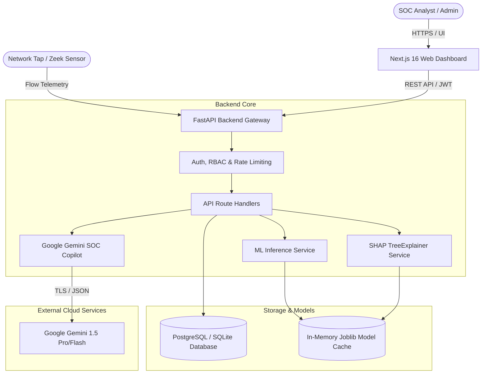
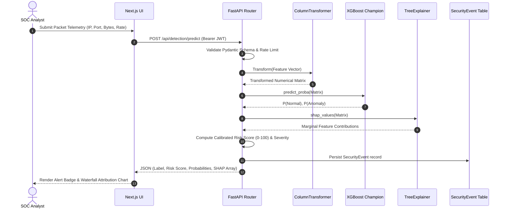
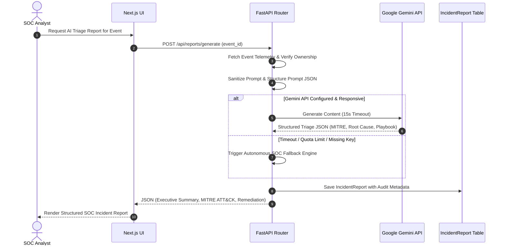
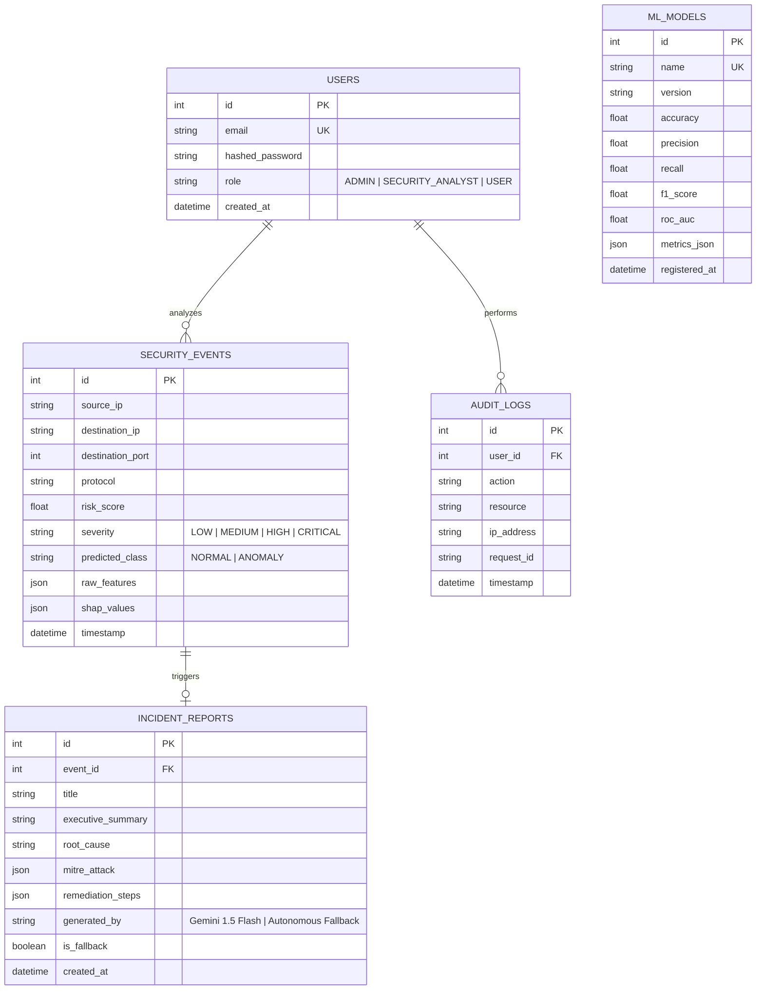

# IntelliTwin AI — Technical System Architecture

This document provides the definitive architectural blueprint of the **IntelliTwin AI** cybersecurity anomaly detection and Generative AI incident triage platform.

---

## 1. System Context & Overview

IntelliTwin AI is an end-to-end cyber threat intelligence platform that unifies real-time machine learning anomaly detection, game-theoretic Explainable AI (SHAP), and Large Language Model (LLM) incident response synthesis.

---

## 2. Component Deconstruction

### 2.1 Web Presentation Tier (`frontend/`)
- **Framework**: Next.js 16.4 (App Router) using React 19 and TypeScript 5.
- **Styling & UI**: Tailwind CSS v4 with custom dark cybersecurity theme (graphite `#0d1117`, cyan `#06b6d4`, emerald `#10b981`, rose `#f43f5e`).
- **Data Visualization**: Recharts for dynamic ROC curves, precision-recall curves, and risk gauge dials.
- **Micro-Interactions**: Framer Motion for smooth tab transitions and live radar scan animations.
- **Key Views**:
  - `/dashboard`: High-level operational command center showing live threat distribution and active alerts.
  - `/detection`: Interactive packet injection simulator with real-time SHAP waterfall charts.
  - `/models`: Dynamic model registry, comparative cross-validation metrics, and ROC curves.
  - `/reports`: Archive of verified GenAI SOC incident reports with MITRE ATT&CK mappings.
  - `/settings`: Infrastructure health monitor, runtime logs, and token-gated live audit trail.

### 2.2 API & Business Logic Tier (`backend/`)
- **Framework**: FastAPI on Python 3.12 with asynchronous ASGI event loop.
- **Concurrency Model**: CPU-bound inference (`model.predict_proba`) is offloaded to threadpools using `asyncio.to_thread` to ensure zero blocking of the async event loop.
- **Security Middleware**: Direct bcrypt password hashing, RFC 7519 JWT validation, and sliding window IP rate limiting.
- **Observability**: Structured JSON logging, unique `X-Request-ID` correlation propagation, and `X-Response-Time` header calculation.

### 2.3 Machine Learning & Explainability Engine (`ml-engine/`)
- **Dataset**: Authentic UNSW-NB15 benchmark flow dataset (25,000 stratified flow partition).
- **Preprocessing Pipeline**: Scikit-learn `ColumnTransformer` with `RobustScaler` for numerical outliers and `OrdinalEncoder` for categorical protocols and states, fitted exclusively on training splits.
- **Ensemble Classifiers**:
  - **XGBoost Classifier** (Champion, 94.48% test accuracy, 0.9901 ROC-AUC)
  - **Random Forest** (94.02% test accuracy, 0.9903 ROC-AUC)
  - **Isolation Forest** (Unsupervised baseline, 59.78% test accuracy, 0.8323 ROC-AUC)
- **Explainability (XAI)**: `shap.TreeExplainer` providing local Shapley feature attributions ($\phi$) for every inference.

### 2.4 Generative AI SOC Copilot (`backend/app/services/gemini_service.py`)
- **Engine**: Google Gemini 1.5 Flash/Pro with Pydantic v2 structured output validation.
- **Prompt Injection Defense**: Multi-stage text filtering and structural isolation of raw telemetry.
- **Autonomous Fallback**: Graceful degradation to deterministic threat correlation if API quotas are exhausted or network access is restricted.

---

## 3. Data Flow Architecture

### 3.1 Real-Time Anomaly Detection & SHAP Pipeline

### 3.2 GenAI Tier-3 Incident Report Synthesis

---

## 4. Database Schema (Entity-Relationship)

---

## 5. API Interface Contracts

| Method | Endpoint | Auth | Description |
| :--- | :--- | :--- | :--- |
| `POST` | `/api/auth/login` | Public | Authenticates credentials and returns JWT access token |
| `POST` | `/api/auth/register` | Public | Self-registration for analyst accounts |
| `GET` | `/api/auth/me` | Bearer | Returns active authenticated user identity and role |
| `POST` | `/api/detection/predict` | Bearer | Evaluates network flow, outputs calibrated risk and SHAP |
| `GET` | `/api/detection/presets` | Public | Returns benchmark attack and normal flow presets |
| `GET` | `/api/models/metrics` | Public | Dynamic performance metrics, confusion matrices, and ROC points |
| `GET` | `/api/dashboard/stats` | Public | Aggregated event counts, risk distribution, and attack ratios |
| `POST` | `/api/reports/generate` | Bearer | Synthesizes Gemini GenAI Tier-3 SOC incident report |
| `GET` | `/api/reports/` | Bearer | Retrieves past generated incident triage reports |
| `GET` | `/api/admin/audit-logs` | Admin | Fetches immutable system audit log trail |
| `GET` | `/api/admin/system-health` | Admin | Comprehensive subsystem diagnostics and memory footprint |
| `GET` | `/health` | Public | Operational liveness probe |
| `GET` | `/ready` | Public | Operational readiness probe (DB + Model RAM check) |
